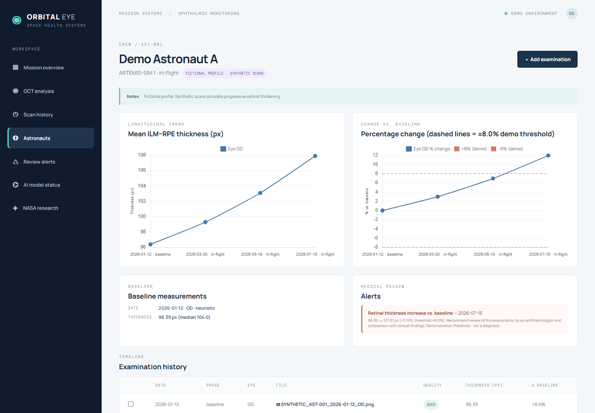
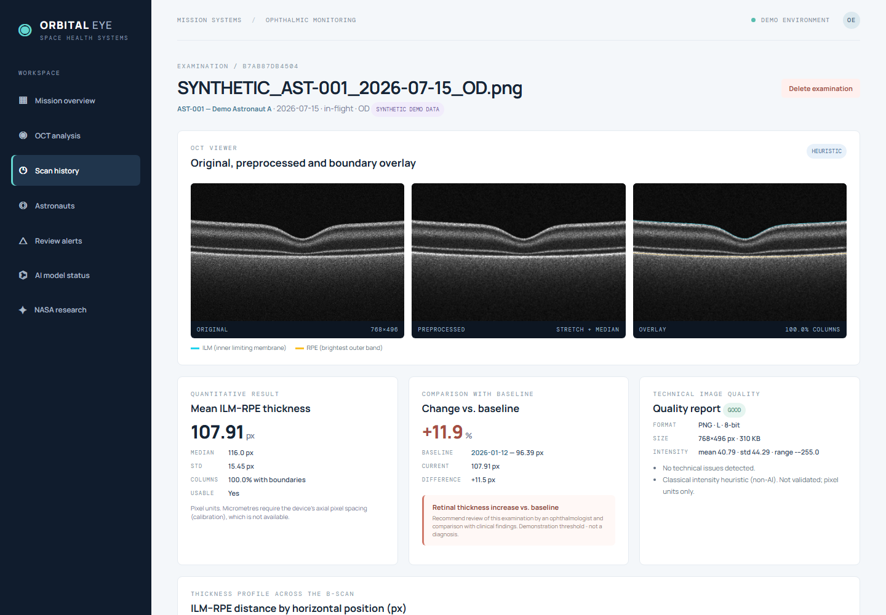
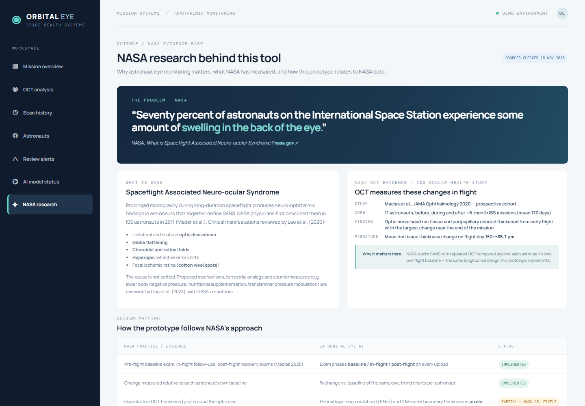

# 👁️ ORBITAL EYE AI

**AI-assisted OCT monitoring of astronaut eye health** — NASA Space Apps Challenge 2026,
*"Create Health Monitoring Software for Astronauts on Space Missions"*.

[](https://github.com/anitoru/orbital_eye_ai/actions/workflows/tests.yml)

> **▶ Live demo:** _link will be added after the Hugging Face Space is published_
>
> Research prototype — **not a medical device, does not diagnose SANS.** Demo astronauts are fictional; their scans are synthetic.



## The problem

NASA reports that *"seventy percent of astronauts on the International Space Station experience some amount of
swelling in the back of the eye"* — part of **Spaceflight Associated Neuro-ocular Syndrome (SANS)**. NASA tracks it
by repeating **OCT eye scans** before, during and after missions and comparing each astronaut with their own
pre-flight baseline (ISS Ocular Health study, Macias et al. 2020).

## What ORBITAL EYE AI does

1. **Upload an OCT scan** for an astronaut (baseline, in-flight or post-flight) — with file and image-quality checks.
2. **Segments the retinal layers** with a **U-Net** deep-learning model and draws them over the scan.
3. **Measures retinal thickness** (in pixels) across the scan.
4. **Compares with the astronaut's baseline** and plots the trend over the mission.
5. **Flags changes for medical review** when they exceed a configurable (demonstration) threshold.

| Examination viewer | NASA research page |
|---|---|
|  |  |

## The AI model

- **Architecture:** U-Net (PyTorch), 9 classes = 7 retinal layers + above/below the retina.
- **Data:** public **Duke DME OCT dataset** (Chiu et al., *Biomed. Opt. Express* 2015) — 110 expert-annotated B-scans
  from 10 patients, split **by patient**: 6 train / 2 validation / 2 test.
- **Training:** Google Colab GPU — fully reproducible with [`training/colab_train.ipynb`](orbital_eye_ai/training/colab_train.ipynb).
- **Results:** held-out test-set metrics (Dice, IoU, boundary error) are produced by the Colab notebook.
- **Limits:** trained on clinical macular scans of patients with diabetic macular edema, **not on astronauts**;
  SANS mainly affects the optic disc, which public datasets do not cover. Validation on NASA astronaut OCT
  (restricted, NASA Life Sciences Data Archive) would be the next step.
- The trained weights are not published here (derived from a dataset whose terms prohibit redistribution).

## Try it yourself

**Option 1 — live demo:** see the link at the top.

**Option 2 — run it (GitHub Codespaces or your computer, Python 3.9+):**

```bash
git clone https://github.com/anitoru/orbital_eye_ai.git
cd orbital_eye_ai/orbital_eye_ai
pip install -r requirements.txt
flask seed-demo        # fictional astronauts with synthetic scans
python app.py          # open http://127.0.0.1:5000
```

Without trained weights the app uses a clearly labelled non-AI boundary method. To use the U-Net, train it with the
Colab notebook (about 30 minutes, free GPU), put `retinal_unet.pt` in `orbital_eye_ai/models/` and run
`pip install -r requirements-ml.txt`.

## Repository map

| Path | What is inside |
|---|---|
| [`orbital_eye_ai/`](orbital_eye_ai/) | The application — full technical README, setup and limitations |
| [`orbital_eye_ai/orbital/`](orbital_eye_ai/orbital/) | Image processing, measurements, monitoring, U-Net and inference |
| [`orbital_eye_ai/training/`](orbital_eye_ai/training/) | Colab notebook, dataset loader, training and evaluation |
| [`orbital_eye_ai/tests/`](orbital_eye_ai/tests/) | Automated tests (run on every push) |
| [`orbital_eye_ai/deploy/`](orbital_eye_ai/deploy/) | Publishing the public demo to Hugging Face Spaces |

## Sources

NASA SANS page · Mader et al., *Ophthalmology* 2011 · Lee et al., *npj Microgravity* 2020 · Macias et al.,
*JAMA Ophthalmology* 2020 · Ong et al., *Br J Ophthalmol* 2023 · NASA OSDR OSD-816 · Chiu et al., *Biomed. Opt. Express* 2015.
Full references with links are on the app's **NASA research** page and in the [technical README](orbital_eye_ai/README.md).

## Team

Built by two biomedical engineering students — [@svetli3020](https://github.com/svetli3020) and [@anitoru](https://github.com/anitoru).
